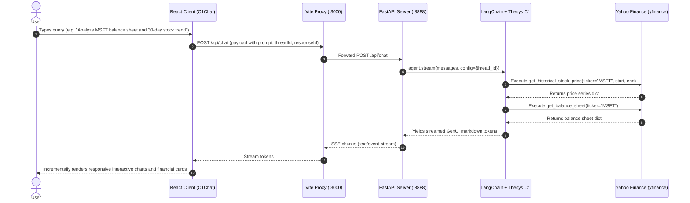

# AI-Powered Financial & Stock Analysis Platform (GenUI)

An intelligent, interactive financial analysis system built using **FastAPI**, **LangChain / LangGraph**, **Yahoo Finance (`yfinance`)**, and **Thesys Generative UI (GenUI)**. The platform enables users to query real-time market data, historical stock and forex price trends, fundamental balance sheets, and market news through an AI conversational agent that streams dynamic, interactive UI widgets (charts, metrics, tables, and cards) directly to a **React 19** frontend.

---

## Table of Contents

- [Architectural Overview](#architectural-overview)
- [System Architecture Diagram](#system-architecture-diagram)
- [End-to-End Data Flow](#end-to-end-data-flow)
- [Repository Structure](#repository-structure)
- [Technical Deep Dive](#technical-deep-dive)
  - [Backend Mechanics (FastAPI + LangChain + LangGraph)](#backend-mechanics-fastapi--langchain--langgraph)
  - [Financial Tools & Data Engine (`yfinance`)](#financial-tools--data-engine-yfinance)
  - [Generative UI & Model Layer (Thesys C1)](#generative-ui--model-layer-thesys-c1)
  - [Frontend Architecture (React 19 + GenUI SDK + Vite)](#frontend-architecture-react-19--genui-sdk--vite)
- [API Reference](#api-reference)
- [Environment Configuration](#environment-configuration)
- [Getting Started](#getting-started)
  - [Prerequisites](#prerequisites)
  - [Backend Setup](#backend-setup)
  - [Frontend Setup](#frontend-setup)
- [Production & Security Considerations](#production--security-considerations)

---

## Architectural Overview

The application follows a decoupled client-server architecture powered by Server-Sent Events (SSE) and Generative UI:

```
+-----------------------------------------------------------------------------------+
|                                 CLIENT (BROWSER)                                  |
|                                                                                   |
|   +---------------------------------------------------------------------------+   |
|   |   React 19 + Vite Frontend (Port 3000)                                    |   |
|   |   - <ThemeProvider mode="dark">                                           |   |
|   |   - <C1Chat apiUrl="/api/chat">                                           |   |
|   |   - @crayonai/react-ui Component System (Charts, Tables, News Cards)      |   |
|   +-------------------------------------+-------------------------------------+   |
+-----------------------------------------|-----------------------------------------+
                                          | Vite Reverse Proxy (`/api` -> `:8888`)
                                          v
+-----------------------------------------------------------------------------------+
|                                FASTAPI BACKEND (:8888)                            |
|                                                                                   |
|   +---------------------------------------------------------------------------+   |
|   |   FastAPI Service (`main.py`)                                             |   |
|   |   - Endpoint: POST /api/chat                                              |   |
|   |   - Session State: LangGraph `InMemorySaver` (thread_id keyed)            |   |
|   +-------------------------------------+-------------------------------------+   |
|                                         |                                         |
|                                         v                                         |
|   +---------------------------------------------------------------------------+   |
|   |   LangChain ReAct Agent Layer                                             |   |
|   |   - `create_agent`                                                        |   |
|   |   - LLM: `ChatOpenAI` pointing to Thesys C1 (`c1/openai/gpt-5/v-20250930`) |   |
|   +------------------+------------------------------------+-------------------+   |
|                      | Tool Execution                     | SSE Stream Chunks     |
|                      v                                    v                       |
|   +---------------------------------------+   +-------------------------------+   |
|   |   yfinance Tools:                     |   | StreamingResponse             |   |
|   |   * get_stock_price                   |   | (text/event-stream)           |   |
|   |   * get_historical_stock_price        |   |                               |   |
|   |   * get_balance_sheet                 |   +---------------+---------------+   |
|   |   * get_stock_news                    |                   |                   |
|   +---------------------------------------+                   |                   |
+---------------------------------------------------------------|-------------------+
                                                                | SSE Stream
                                                                v
                                                  Client renders live GenUI
```

---

## System Architecture Diagram

```mermaid
flowchart TD
    User([User]) -->|Inputs Prompt| UI["Frontend (C1Chat / @crayonai/react-ui)"]
    UI -->|POST /api/chat| Proxy["Vite Dev Proxy (:3000)"]
    Proxy -->|Forward /api/chat| FastAPIServer["FastAPI Server (:8888)"]
    
    subgraph Backend ["FastAPI Backend"]
        FastAPIServer --> RequestParser["Parse RequestObject (prompt, threadId, responseId)"]
        RequestParser --> Memory["LangGraph InMemorySaver (thread_id state)"]
        Memory --> Agent["LangChain Agent (Thesys C1 Model)"]
        
        Agent -->|Function Calling| Tools["Yahoo Finance (yfinance) Tools"]
        Tools -->|Price Data| Tool1["get_stock_price"]
        Tools -->|Date Range Series| Tool2["get_historical_stock_price"]
        Tools -->|Balance Sheet DF| Tool3["get_balance_sheet"]
        Tools -->|Feed List| Tool4["get_stock_news"]
        
        Tool1 & Tool2 & Tool3 & Tool4 -->|Raw Financial Data| Agent
        Agent -->|Token Stream / GenUI Markdown| StreamEngine["FastAPI StreamingResponse"]
    end
    
    StreamEngine -->|SSE (text/event-stream)| UI
    UI -->|Render Interactive UI Components| User
```

---

## End-to-End Data Flow



---

## Repository Structure

```
stock_analysis/
├── backend/
│   ├── .env                    # Environment variables (API keys)
│   ├── .env.example            # Sample environment variables file
│   ├── .gitignore              # Git ignore rules for Python artifacts & venv
│   ├── .python-version         # Python version pin (3.11)
│   ├── main.py                 # FastAPI app, LangChain agent, and yfinance tools
│   ├── pyproject.toml          # Project dependencies and packaging metadata
│   ├── README.md               # Backend-specific technical documentation
│   └── uv.lock                 # Deterministic dependency lockfile
├── frontend/
│   ├── public/                 # Static assets (favicons, Vite logo)
│   ├── src/
│   │   ├── assets/             # Component asset files
│   │   ├── App.css             # Layout and typography styling (Roboto, 100% viewport)
│   │   ├── App.tsx             # Root component wrapping C1Chat and ThemeProvider
│   │   └── main.tsx            # React DOM bootstrap entrypoint
│   ├── .gitignore              # Git ignore rules for node_modules, build outputs
│   ├── eslint.config.js        # Modern flat ESLint configuration
│   ├── index.html              # HTML shell
│   ├── package.json            # Node.js dependencies, scripts, and engine specs
│   ├── package-lock.json       # Deterministic npm lockfile
│   ├── README.md               # Frontend-specific technical documentation
│   ├── tsconfig.app.json       # TypeScript compiler options for React application
│   ├── tsconfig.json           # Root TypeScript project references configuration
│   ├── tsconfig.node.json      # TypeScript compiler options for Vite config
│   └── vite.config.ts          # Vite build config & reverse proxy configuration
└── README.md                   # Complete system technical overview (this document)
```

---

## Technical Deep Dive

### Backend Mechanics (FastAPI + LangChain + LangGraph)

The backend (`backend/main.py`) exposes an asynchronous HTTP server using `FastAPI` and `uvicorn`:

1. **State & Conversation Threading**:
   - Uses `langgraph.checkpoint.memory.InMemorySaver` as an in-memory checkpointer.
   - Every user conversation is uniquely identified by `threadId` provided in the request payload.
   - When calling `agent.stream()`, `config={'configurable': {'thread_id': request.threadId}}` ensures conversation state and context persist across multiple interaction turns within the same thread.

2. **ReAct Agent Construction**:
   - `create_agent(model=model, checkpointer=checkpointer, tools=[...])` initializes an autonomous agent that reasons over user intent, formulates tool call invocations, interprets tool execution outputs, and streams responses.

3. **Streaming Protocol**:
   - Implements `StreamingResponse(generate(), media_type='text/event-stream')`.
   - The generator yields raw token strings generated by `agent.stream(..., stream_mode='messages')`.
   - Headers configured:
     - `Cache-Control: no-cache, no-transform` (prevents buffering by intermediate proxies).
     - `Connection: keep-alive` (maintains the persistent HTTP stream).

---

### Financial Tools & Data Engine (`yfinance`)

Four modular LangChain tools are registered with docstrings and type annotations to enable precise LLM tool selection:

| Tool Name | Parameters | Description & Normalization | Returns |
| :--- | :--- | :--- | :--- |
| `get_stock_price` | `ticker: str` | Fetches current price (5-day window, latest close). Auto-converts 6-letter alphabetic tickers (e.g., `EURUSD`) to Yahoo forex format (`EURUSD=X`). | `float` (latest closing price) or `{"error": str}` |
| `get_historical_stock_price` | `ticker: str`, `start_date: str`, `end_date: str` | Retrieves historical closing price series between `start_date` and `end_date` (ISO `YYYY-MM-DD`). | `dict` mapping timestamp to closing prices |
| `get_balance_sheet` | `ticker: str` | Retrieves annual/quarterly balance sheet metrics. Rejects forex pairs with a descriptive error. Fills NaN values with empty strings. | `dict` of financial line items or error dict |
| `get_stock_news` | `ticker: str` | Queries latest news articles for the stock and returns the top 5 stories with titles, publishers, and URLs. | `list[dict]` (up to 5 news items) |

---

### Generative UI & Model Layer (Thesys C1)

- **Model**: `c1/openai/gpt-5/v-20250930`
- **Base URL**: `https://api.thesys.dev/v1/embed/`
- **Provider**: Thesys GenUI engine.
- Rather than outputting static plain text or markdown tables, the model outputs structured GenUI declarations that map to rich components supported by `@crayonai/react-ui`. These include interactive time-series price charts, metric cards, key performance indicators (KPIs), expandable balance sheet matrices, and news feed previews.

---

### Frontend Architecture (React 19 + GenUI SDK + Vite)

The frontend is a single-page React 19 application configured with TypeScript and Vite:

1. **Component Hierarchy**:
   - `main.tsx` mounts `<App />` within React 19 `StrictMode`.
   - `App.tsx` configures `<ThemeProvider mode="dark">` to apply cohesive dark-mode styling across all GenUI primitives.
   - `<C1Chat apiUrl="/api/chat" />` handles chat state, message history, user input controls, network requests, streaming response assembly, and dynamic rendering of UI components from `@crayonai/react-ui`.
2. **Reverse Proxying**:
   - Configured in `vite.config.ts`:
     ```ts
     server: {
       port: 3000,
       proxy: {
         '/api': {
           target: 'http://localhost:8888',
           changeOrigin: true
         }
       }
     }
     ```
   - Eliminates cross-origin resource sharing (CORS) friction during local development and seamlessly forwards streaming SSE responses.

---

## API Reference

### `POST /api/chat`

Initiates or continues a multi-turn stock analysis conversation.

#### Request Headers
```http
Content-Type: application/json
```

#### Request Payload Schema
```typescript
interface RequestObject {
  prompt: {
    content: string; // The user's query or instruction
    id: string;      // Unique identifier for the message
    role: string;    // "user" | "assistant" | "system"
  };
  threadId: string;   // Unique session ID for LangGraph memory checkpointing
  responseId: string; // ID assigned to the expected response
}
```

#### Request Example
```json
{
  "prompt": {
    "content": "What is the current stock price of NVDA and show me its balance sheet?",
    "id": "msg_001",
    "role": "user"
  },
  "threadId": "session_abc123",
  "responseId": "resp_001"
}
```

#### Response
- **Status Code**: `200 OK`
- **Content-Type**: `text/event-stream`
- **Body**: Chunked stream of string tokens / GenUI serialized components.

---

## Environment Configuration

Create a `.env` file in the `backend/` directory based on `backend/.env.example`:

```bash
# backend/.env
OPENAI_API_KEY=your_thesys_api_key_here
```

| Variable | Description | Default / Format | Required |
| :--- | :--- | :--- | :--- |
| `OPENAI_API_KEY` | Thesys C1 GenUI API key (compatible with ChatOpenAI client) | `sk-th-...` | **Yes** |

---

## Getting Started

### Prerequisites

- **Python**: Version `3.11` or higher
- **Node.js**: Version `18.x`, `20.x`, or higher
- **Package Managers**:
  - Python: `uv` (recommended) or `pip`
  - JavaScript: `npm`, `pnpm`, or `yarn`

---

### Backend Setup

1. **Navigate to the backend directory**:
   ```bash
   cd backend
   ```

2. **Create and activate a virtual environment**:
   ```bash
   # Using standard venv
   python -m venv .venv

   # On Windows PowerShell:
   .venv\Scripts\Activate.ps1

   # On Linux/macOS:
   source .venv/bin/activate
   ```

3. **Install dependencies**:
   ```bash
   # Using uv (fastest)
   uv sync

   # Or using pip
   pip install -e .
   ```

4. **Configure environment variables**:
   ```bash
   cp .env.example .env
   # Ensure your valid API key is set in .env
   ```

5. **Start the backend server**:
   ```bash
   python main.py
   # Or using uvicorn directly with hot reload:
   uvicorn main:app --host 0.0.0.0 --port 8888 --reload
   ```
   The backend will be running at `http://localhost:8888`.

---

### Frontend Setup

1. **Open a new terminal and navigate to the frontend directory**:
   ```bash
   cd frontend
   ```

2. **Install dependencies**:
   ```bash
   npm install
   ```

3. **Start the Vite development server**:
   ```bash
   npm run dev
   ```
   The frontend will be running at `http://localhost:3000`.

4. **Access the application**:
   Open `http://localhost:3000` in your browser.

---

## Production & Security Considerations

1. **State Persistence**:
   - `InMemorySaver` stores thread state in volatile RAM. For production deployments with multiple instances or restarts, swap `InMemorySaver` with persistent backends such as `PostgresSaver` or `RedisSaver`.
2. **Secret Management**:
   - Never commit `.env` or production API keys to source control. Ensure `.env` is listed in `.gitignore`.
3. **CORS Restrictions**:
   - When serving the frontend and backend on separate domains in production, explicitly configure allowed origins in FastAPI's `CORSMiddleware`.
4. **Rate Limiting & Caching**:
   - Free Yahoo Finance queries through `yfinance` can encounter rate limits if queried heavily. Consider adding an in-memory or Redis caching layer for frequent queries (e.g. 1-minute TTL for real-time quotes, 24-hour TTL for balance sheets).
